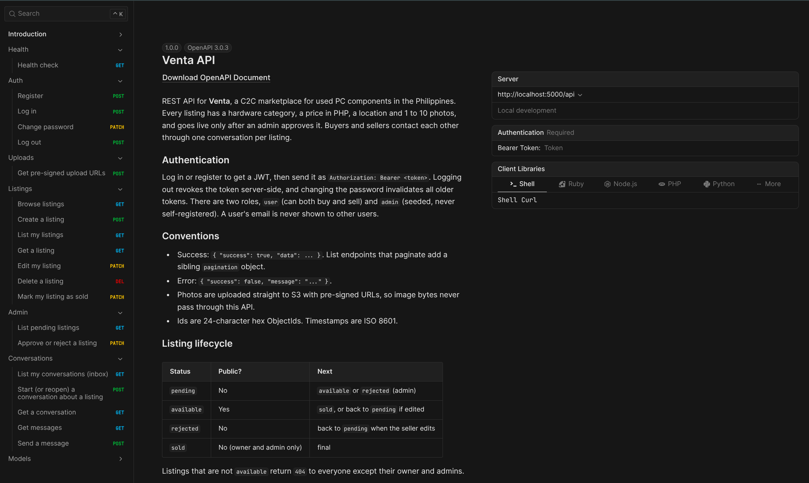

# Venta

A C2C marketplace for used PC components in the Philippines. Every listing is reviewed by an admin before it goes live.

> **Status:** Backend API & testing complete (v0.4). Building frontend integration (v0.5).
>
> **Interactive API Documentation:** [https://edrylp.github.io/venta-dev/](https://edrylp.github.io/venta-dev/)


## Interactive API Reference

Click the preview below to explore the API reference:

[](https://edrylp.github.io/venta-dev/)

### Key Highlights
- **REST Endpoints:** Complete workflows for Authentication, Listings CRUD, S3 Pre-signed Uploads, Admin Moderation, and Buyer-Seller Conversations & Messages.
- **Listing Moderation Lifecycle:** Strict state machine (`pending` to `available` / `rejected`). Editing an active listing triggers re-moderation to prevent unauthorized modifications.
- **Direct S3 Uploads:** Pre-signed S3 URLs enforce per-user prefix isolation (`listings/<userId>/...`), image count limits (1–10), and 5 MB file caps while keeping AWS credentials strictly on the backend.
- **JWT Revocation:** Instant token revocation on logout tracked via MongoDB TTL index (`RevokedToken`), removing expired tokens automatically.
- **Input Validation & Security:** Request bodies and query parameters validated via VineJS schemas, protected against NoSQL injection via Mongoose `sanitizeFilter`.
- **Automated Testing Suite:** 100 integration and permission test cases covering RBAC, ownership guards, and edge cases via Vitest, Supertest, and an in-memory MongoDB server.


## The Problem

Buying and selling used PC hardware on general-purpose platforms is messy: listings are buried among unrelated items, parts are described inconsistently, prices fluctuate wildly, and buyers have no assurance that a listing was moderated or verified.

## What It Does (MVP)

- **Listing Discovery:** Browse, search, filter by 9 hardware categories, and sort approved listings.
- **Listing Management:** Post and edit listings with 1 to 10 photos uploaded directly to S3; edits to approved items return to `pending` review.
- **Admin Moderation:** Admins review incoming listings and approve or reject them with mandatory feedback (`rejectionReason`).
- **Direct Messaging:** Buyers and sellers converse directly within the platform regarding specific listings.
- **Auth & Security:** Register, log in, manage passwords, and log out with instant JWT invalidation.

*Out of scope for MVP: Payments, shipping logistics, real-time WebSockets, and user ratings. See the [PRD](docs/PRD.md).*


## Tech Stack

| Layer | Tools |
|---|---|
| **Backend** | Node.js, Express 5, MongoDB Atlas (Mongoose), JWT, bcrypt |
| **Validation & Docs** | VineJS (`@vinejs/vine`), OpenAPI 3.0.3, Scalar |
| **Testing** | Vitest, Supertest, `mongodb-memory-server` |
| **Cloud Storage & Serverless** | AWS S3 (pre-signed direct uploads), AWS Lambda + API Gateway (`serverless-http`), Vercel |
| **Frontend** | React, Vite, Tailwind CSS, React Router, Zustand, Axios *(in progress)* |


## Repository Structure

```text
venta/
├── client/                        # React (Vite) frontend (in progress)
│   ├── .env                       # Frontend environment variables (gitignored)
│   └── .env.example               # Environment variable template
├── docs/
│   ├── assets/
│   │   └── api-reference.png      # API documentation screenshot preview
│   ├── index.html                 # Scalar API Reference (hosted on GitHub Pages)
│   ├── openapi.yaml               # OpenAPI 3.0.3 specification
│   ├── PRD.md                     # Product Requirements Document
│   └── TSD.md                     # Technical Specification Document
├── server/
│   ├── scripts/
│   │   └── seedAdmin.js           # Admin-seeding script
│   ├── src/
│   │   ├── config/
│   │   │   ├── database.js        # Cached MongoDB connection with sanitizeFilter
│   │   │   └── vine.js            # VineJS custom error messages provider
│   │   ├── controllers/           # auth, listing, upload, conversation, message
│   │   ├── middleware/            # protect, authorize, validate, errorHandler
│   │   ├── models/                # User, Listing, Conversation, Message, RevokedToken
│   │   ├── routes/                # auth, listing, upload, conversation, message, admin
│   │   ├── utils/                 # s3, generateToken
│   │   ├── validators/            # VineJS request validation schemas
│   │   ├── app.js                 # Express application configuration
│   │   └── server.js              # Local development server entrypoint
│   ├── tests/                     # Vitest + Supertest integration & permission suites
│   ├── vitest.config.js           # Test runner configuration
│   ├── .env                       # Backend environment variables (gitignored)
│   ├── .env.example               # Environment variable template
│   └── package.json
└── README.md
```

## Getting Started (Local Development)

### Prerequisites

- Node.js (LTS)
- MongoDB Atlas cluster or local MongoDB instance
- AWS S3 bucket with IAM credentials configured for pre-signed URLs

### Setup

1. **Clone the repository:**
   ```bash
   git clone git@github.com:edrylp/venta-dev.git
   cd venta-dev
   ```

2. **Configure backend environment variables:**
   ```bash
   cd server
   cp .env.example .env
   # Populate .env with Secrets and AWS credentials/details
   ```

3. **Install dependencies and start development server:**
   ```bash
   npm install
   npm run dev
   ```

4. **Seed an initial admin account:**
   ```bash
   npm run seedadmin
   # Make sure .env has admin credentials
   ```

### Running Tests

The test suite runs against an isolated, in-memory MongoDB instance without requiring an external database connection:

```bash
cd server
npm test
```


## Documentation

- **[API Documentation (GitHub Pages)](https://edrylp.github.io/venta-dev/)** - Live interactive Scalar reference rendered from [openapi.yaml](docs/openapi.yaml)
- **[OpenAPI 3.0.3 Specification](docs/openapi.yaml)** - API specification
- **[Product Requirements Document (PRD)](docs/PRD.md)** - User stories, feature scopes, and business rules
- **[Technical Specification Document (TSD)](docs/TSD.md)** - Architectural design, schemas, API endpoints, and cloud infrastructure


## Roadmap

- [x] **v0.1 Documentation:** PRD, TSD, architecture diagrams
- [x] **v0.2 Project Setup:** Monorepo scaffolding, environment variables, Express setup
- [x] **v0.3 Database & Auth:** Mongoose schemas, JWT authentication, token revocation, VineJS validation
- [x] **v0.4 Backend Core & API:** Listings CRUD, S3 pre-signed uploads, admin moderation, conversations/messaging, OpenAPI 3.0.3 spec and GitHub Pages docs
- [ ] **v0.5 Frontend Integration:** React + Tailwind CSS client, Zustand state stores, auth flows, and listing management
- [ ] **v0.6 Serverless Deployment:** AWS Lambda + API Gateway deployment, Vercel frontend hosting
- [ ] **v0.7 Polish & Release:** Live demo, sample data seeding, UI screenshots, demo credentials


## Author

Edryl Palinis
