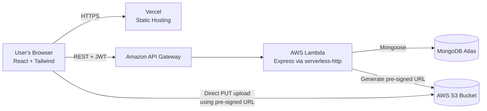
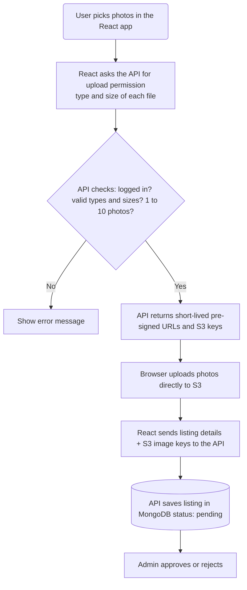
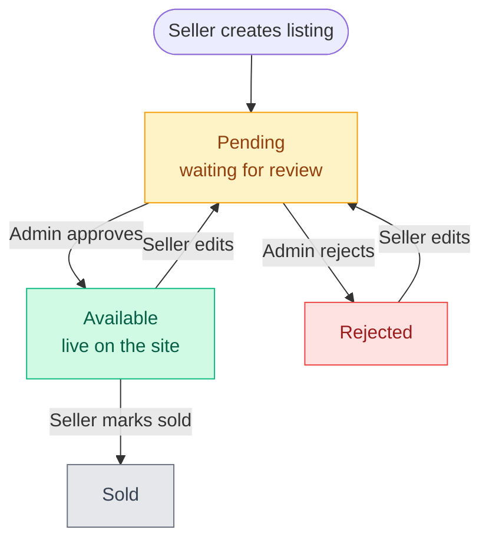
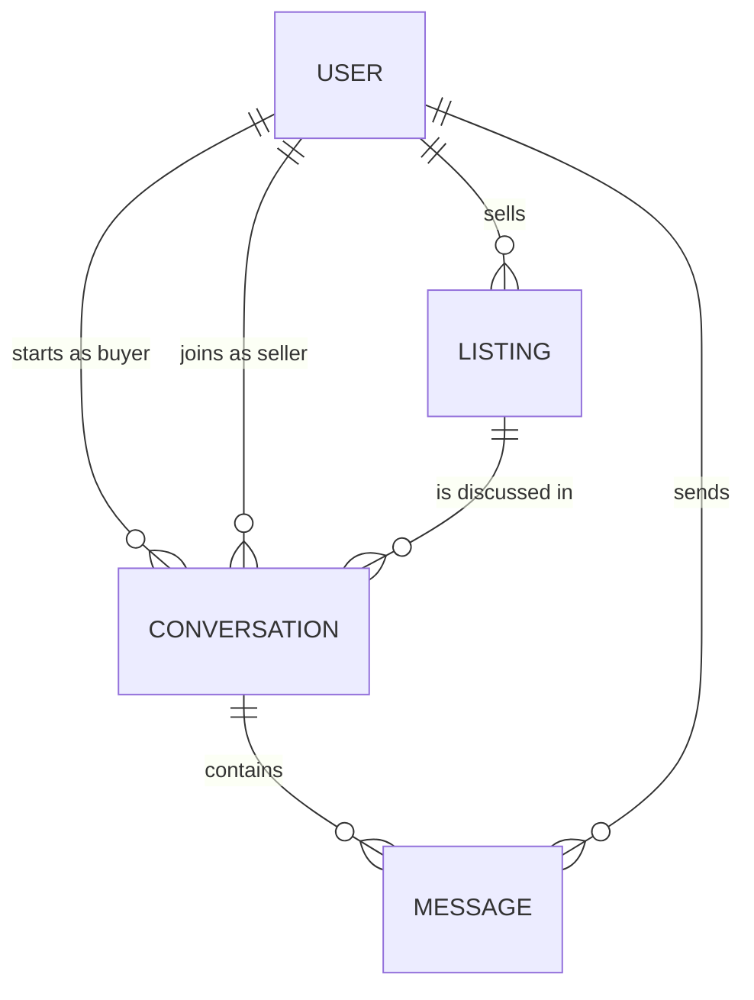

# Venta — Technical Specification Document (TSD)

> **Venta** is a C2C marketplace for used PCs and PC components.

> **Author:** Edryl Palinis · **Version:** 1.0

> **Stack:** React · Tailwind CSS · Zustand · Node.js/Express (`serverless-http`) · VineJS (`@vinejs/vine`) · MongoDB Atlas (Mongoose) · JWT · AWS S3 · AWS Lambda + API Gateway · Vercel

---

## Table of Contents

1. [Project Overview & Objectives](#1-project-overview--objectives)
2. [System Architecture & Data Flow](#2-system-architecture--data-flow)
3. [Database Schema & Mongoose Models](#3-database-schema--mongoose-models)
4. [API Endpoints & Routes](#4-api-endpoints--routes-restful)
5. [Cloud Infrastructure & Security Considerations](#5-cloud-infrastructure--security-considerations)
6. [Development & Deployment Plan (SDLC Workflow)](#6-development--deployment-plan-sdlc-workflow)
7. [Appendix: Future Improvements](#7-appendix-future-improvements)

---

## 1. Project Overview & Objectives

### 1.1 The Problem

Buying and selling used PC hardware on general-purpose platforms is messy. Listings are buried among unrelated items, there's no consistent way to describe a part, prices are inconsistent, and buyers have no assurance that a listing was reviewed by anyone. Hardware is expensive and easy to misrepresent, so structure and moderation matter.

### 1.2 The Solution

**Venta** is a focused, peer-to-peer (C2C) marketplace where anyone can sell and buy used computer hardware. Every listing:

- belongs to a **hardware category** (Desktop, Processor, GPU, etc.),
- has a stated **price** in Philippine pesos (PHP),
- includes **1 to 10 photos**,
- is **reviewed by an admin** before going live.

### 1.3 User Roles

| Role | Capabilities |
|------|--------------|
| **Guest** | Browse listings, view item details, search and filter. Cannot post or message sellers. |
| **User** (Buyer & Seller) | Everything a guest can do, plus: register/login/logout, change password, create/edit/delete own listings, upload 1 to 10 photos per listing, message other users. |
| **Admin** | Review pending listings and approve or reject them. Delete any listing. |

### 1.4 Supported Categories

`Desktop`, `Processor`, `GPU`, `Motherboard`, `RAM`, `Storage`, `PSU`, `Cooler`, `Case`

### 1.5 MVP Goals

The MVP is intentionally small. Each goal exists to demonstrate a specific skill:

| # | Goal | Skill Demonstrated |
|---|------|--------------------|
| 1 | Register, log in, and stay logged in with JWT | Authentication & authorization |
| 2 | Create, read, update, delete listings with filters | REST API design, MongoDB querying, request validation |
| 3 | Upload 1 to 10 photos per listing directly to S3 | Cloud storage, secure credential handling |
| 4 | Admin approval workflow for listings | Role-based access control, state machines |
| 5 | Basic user-to-user messaging about a listing | Data modeling with references |
| 6 | Deploy frontend to Vercel, backend to AWS Lambda | Serverless deployment, CI/CD basics |

### 1.6 Out of Scope (for the MVP)

Real-time chat (WebSockets), reviews/ratings, email notifications, password reset by email. These are listed in the [Appendix](#7-appendix-future-improvements). Payments, `dealMethod`, and shipping/meetup arrangements are also out of scope; buyer and seller agree on them through messages. 

---

## 2. System Architecture & Data Flow

### 2.1 Architecture



**How to explain it in an interview:**

- **Vercel** serves the React app (static files). It never touches my database or AWS keys.
- **API Gateway** is the public front door for my backend. It routes HTTP requests to Lambda and can throttle abusive traffic.
- **Lambda** runs my Express app. `serverless-http` translates API Gateway events into something Express understands, so I can write a normal Express app and deploy it serverlessly.
- **MongoDB Atlas** stores users, listings, conversations, and messages.
- **S3** stores images. The browser uploads photos **directly** to S3 using a short-lived pre-signed URL, so images never pass through Lambda.

### 2.2 Photo Upload Flow

The browser uploads photos straight to S3 using a temporary link from my API, the server never handles the image files and AWS keys never reach the frontend.



### 2.3 Listing Status Lifecycle

Every new listing starts as Pending. An admin either approves or rejects it. Editing a rejected or available listing sends it back to Pending for review, so content can't be changed after approval. Editing a pending listing keeps it pending, and a sold listing can't be edited. When the item is sold, the seller can mark it as Sold.

| Status | Meaning | Visible to public? | Next possible status |
|--------|---------|--------------------|----------------------|
| `pending` | Waiting for admin review | No | `available`, `rejected` |
| `available` | Admin-approved, live on the site | Yes | `sold`, or `pending` if edited |
| `rejected` | Admin said no (with a reason) | No | `pending` after the seller edits |
| `sold` | Item is sold | No (owner and admin only) | None (final) |



> **Design decision:** Editing an `available` listing sends it back to `pending`. Otherwise a seller could get an innocent listing approved and then swap in misleading content.

---

## 3. Database Schema & Mongoose Models

MongoDB is document-based, so we model relationships with **references** (`ObjectId` + `ref`) and use `populate()` when we need related data.



### 3.1 `User` Model

```js
// src/models/User.js
import mongoose from "mongoose";
import bcrypt from "bcrypt";

const userSchema = new mongoose.Schema(
  {
    username: {
      type: String,
      required: [true, "Username is required"],
      trim: true,
      lowercase: true,
      minlength: [4, "Username must be at least 4 characters"],
      maxlength: [15, "Username cannot exceed 15 characters"],
      match: [
        /^[a-z0-9_]+$/,
        "Username may contain only lowercase letters, numbers, and underscores",
      ],
      unique: true,
      immutable: true,
    },
    email: {
      type: String,
      required: [true, "Email is required"],
      unique: true,
      lowercase: true,
      trim: true,
      match: [/^\S+@\S+\.\S+$/, "Please provide a valid email"],
    },
    password: {
      type: String,
      required: [true, "Password is required"],
      minlength: [8, "Password must be at least 8 characters"],
      select: false, 
    },
    passwordChangedAt: {
      type: Date,
      default: null,
      select: false,
    },
    role: {
      type: String,
      enum: ["user", "admin"],
      default: "user",
    },
  },
  { timestamps: true }
);

userSchema.pre("save", async function () {
  if (!this.isModified("password")) return;

  this.password = await bcrypt.hash(this.password, 12);

  if (!this.isNew) {
    this.passwordChangedAt = Date.now() - 1000;
  }
});

userSchema.methods.matchPassword = async function (enteredPassword) {
  return await bcrypt.compare(enteredPassword, this.password);
};

userSchema.methods.changedPasswordAfter = function (JWTTimestamp) {
  if (this.passwordChangedAt) {
    const changedTimestamp = parseInt(
      this.passwordChangedAt.getTime() / 1000,
      10
    );
    return JWTTimestamp < changedTimestamp;
  }
  return false;
};

export default mongoose.models.User || mongoose.model("User", userSchema);
```

> **Why `mongoose.models.User ||`?** Lambda can reuse a "warm" container, and Mongoose throws an error if you register the same model twice. This guard prevents that.

> **Privacy:** The `username` is the only identity shown to other users. The email is used to log in and is never returned in public responses (listings, conversations).

> **Password length:** Passwords must be 8 to 72 characters. The upper bound is enforced in the validation layer (see 5.4), not in this schema. bcrypt only uses the first 72 bytes of its input, so a longer password would be silently truncated. The limit is counted in characters, so a password with multi-byte characters can still exceed 72 bytes. That edge case is accepted for the MVP.

### 3.2 `Listing` Model

```js
// src/models/Listing.js
import mongoose from "mongoose";
import { publicUrl, MAX_FILES } from "../utils/s3.js";

export const CATEGORIES = [
  'Desktop', 'Processor', 'GPU', 'Motherboard', 'RAM', 'Storage',
  'PSU', 'Cooler', 'Case',
];

const listingSchema = new mongoose.Schema(
  {
    userId: {
      type: mongoose.Schema.Types.ObjectId,
      ref: "User",
      required: true,
    },
    category: {
      type: String,
      required: [true, "Category is required"],
      enum: CATEGORIES
    },
    title: {
      type: String,
      required: [true, "Listing title is required"],
      maxlength: [100, "Title cannot exceed 100 characters"],
      trim: true,
    },
    // Price in Philippine pesos (PHP)
    price: {
      type: Number,
      required: [true, "Price is required"],
      min: [1, "Price must be at least 1"],
    },
    description: {
      type: String,
      required: [true, "Listing description is required"],
      minlength: [10, "Listing description is too short"],
      maxlength: [4000, "Listing description cannot exceed 4000 characters"],
      trim: true,
    },
    location: {
      type: String,
      required: [true, "Location is required"],
      trim: true,
      maxlength: [100, "Location cannot exceed 100 characters"],
    },
    // S3 object keys, not URLs. URLs are built by the imageUrls virtual.
    images: {
      type: [String],
      validate: [
        (v) => v.length >= 1 && v.length <= MAX_FILES,
        `A listing needs 1 to ${MAX_FILES} photos`,
      ],
    },
    status: {
      type: String,
      enum: ["pending", "available", "rejected", "sold"],
      default: "pending",
    },
    // Required when an admin rejects (checked in the controller); cleared when the seller resubmits
    rejectionReason: { type: String, trim: true, maxlength: 500 },
  },
  { timestamps: true, toJSON: { virtuals: true }, id: false },
);

// Seller's listings, newest first
listingSchema.index({ userId: 1, createdAt: -1 });

// Public listings, newest first (default view)
listingSchema.index({ status: 1, createdAt: -1 });

// Public listings, sorted by price
listingSchema.index({ status: 1, price: 1 });

// Public listings filtered by category and sorted by price
listingSchema.index({ category: 1, status: 1, price: 1 });

// Keyword search
listingSchema.index({ title: "text", description: "text" });

listingSchema.virtual("imageUrls").get(function () {
  return (this.images ?? []).map(publicUrl);
});

export default mongoose.models.Listing || mongoose.model("Listing", listingSchema);
```

> **Why keys, not URLs?** A key like `listings/<userId>/<uuid>.jpg` doesn't change if the bucket, region, or CDN changes, and it is easy to validate (it must start with the uploader's own prefix, see 5.4). Public URLs are built on the way out from `S3_PUBLIC_BASE_URL`.

> **Updating listings:** Mongoose runs custom validators on `save()` but not on `findByIdAndUpdate()` unless `runValidators: true` is set. Update by loading the document, assigning only whitelisted fields, and calling `doc.save()`, so the image-count rule always applies. This also keeps the ownership check and status transition in one place.

### 3.3 `Conversation` Model

One conversation is one buyer talking to one seller about one listing. The seller is the listing's owner.

```js
// src/models/Conversation.js
import mongoose from "mongoose";

const conversationSchema = new mongoose.Schema(
  {
    listingId: {
      type: mongoose.Schema.Types.ObjectId,
      ref: "Listing",
      required: true,
    },
    buyerId: {
      type: mongoose.Schema.Types.ObjectId,
      ref: "User",
      required: true,
    },
    sellerId: {
      type: mongoose.Schema.Types.ObjectId,
      ref: "User",
      required: true,
    },
    lastMessage: {
      type: String,
      trim: true,
      default: null,
    },
    lastMessageAt: {
      type: Date,
      default: null,
    },
  },
  { timestamps: true },
);

// One conversation per buyer per listing
conversationSchema.index(
  { buyerId: 1, listingId: 1 },
  { unique: true }
);

// Seller inbox, newest activity first
conversationSchema.index({ sellerId: 1, lastMessageAt: -1 });

// Buyer inbox, newest activity first
conversationSchema.index({ buyerId: 1, lastMessageAt: -1 });

export default mongoose.models.Conversation || mongoose.model("Conversation", conversationSchema);
```

### 3.4 `Message` Model

```js
// src/models/Message.js
import mongoose from "mongoose";

const messageSchema = new mongoose.Schema(
  {
    conversationId: {
      type: mongoose.Schema.Types.ObjectId,
      ref: "Conversation",
      required: true,
    },
    senderId: {
      type: mongoose.Schema.Types.ObjectId,
      ref: "User",
      required: true,
    },
    content: {
      type: String,
      required: [true, "Message content is required"],
      trim: true,
      minlength: [1, "Message cannot be empty"],
      maxlength: [1000, "Message cannot exceed 1000 characters"],
    },
  },
  { timestamps: true },
);

messageSchema.index({ conversationId: 1, createdAt: -1 });

export default mongoose.models.Message || mongoose.model("Message", messageSchema);
```

> **How conversations work:** The inbox is two plain queries on `buyerId` or `sellerId`, sorted by `lastMessageAt`, with the listing populated for its title and status. The conversation stores a denormalized `lastMessage` preview, so the inbox never has to look at the messages collection.
>
> **Sending a message** creates the `Message`, then updates the conversation's `lastMessage` and `lastMessageAt`. These two writes are not in a transaction: if the second one fails, the inbox preview is briefly stale but no message is lost. That trade-off is accepted for the MVP.
>
> **Deleted or unavailable listings:** Deleting a listing does **not** delete its conversations or messages. The conversation stays in both users' inboxes and its history stays readable. The populated `listingId` is `null`, and the UI shows "Listing no longer available". If a listing is not `available` (pending, rejected, sold, or deleted), the conversation can't receive new messages. The link to the listing returns `404` when the listing is deleted, and also for buyers when it is pending, rejected, or sold, because only the owner and admins can open those (see 4.2).

### 3.5 `RevokedToken` Model

Logout revokes a token by storing its `jti` (the unique ID inside the JWT). `protect` checks this collection on every protected request.

```js
// src/models/RevokedToken.js
import mongoose from "mongoose";

const revokedTokenSchema = new mongoose.Schema({
  jti: { type: String, required: true, unique: true },
  expiresAt: { type: Date, required: true },
});

// MongoDB deletes each document once expiresAt has passed
revokedTokenSchema.index({ expiresAt: 1 }, { expireAfterSeconds: 0 });

export default mongoose.models.RevokedToken || mongoose.model("RevokedToken", revokedTokenSchema);
```

> **Why a TTL index?** A revoked token only has to be remembered until it would have expired anyway. MongoDB removes each entry once `expiresAt` passes, so the collection stays small. It has no relations to other collections, so it is not in the ER diagram.

### 3.6 Cached Database Connection (Important for Lambda)

Lambda may handle many requests in the same container. Opening a new database connection on every request would be slow and could exhaust Atlas connection limits, so we cache the connection outside the handler:

```js
// src/config/database.js
import mongoose from "mongoose";

const cached = {
  conn: null,
  promise: null,
};

mongoose.set('sanitizeFilter', true); 

const connectDatabase = async () => {
  if (cached.conn) {return cached.conn;}

  if (!cached.promise) {
    cached.promise = mongoose
      .connect(process.env.MONGODB_URI, {
        bufferCommands: false,
        maxPoolSize: 5,
        serverSelectionTimeoutMS: 5000,
      })
      .then(() => {
        console.log("MongoDB connected successfully");
        return mongoose.connection;
      })
      .catch((error) => {
        cached.promise = null;
        throw error;
      });
  }

  try {
    cached.conn = await cached.promise;
    return cached.conn;
  } catch (error) {
    console.error("MongoDB connection failed:", error);
    throw error;
  }
};

export default connectDatabase;
```

> **Where `.env` is loaded:** only in `server.js` (local dev), as its first import (`import "dotenv/config"`), so the variables exist before any other module reads them. This file does not load it. On Lambda, variables come from the function's environment configuration and no `.env` file is deployed. Tests and scripts load their own env: set it in the Vitest config, and import `dotenv/config` at the top of the admin seed script.

---

## 4. API Endpoints & Routes (RESTful)

**Base URL:** `https://<api-id>.execute-api.<region>.amazonaws.com/api` (local: `http://localhost:<PORT>/api`)

- **Path prefix:** Express mounts every router under `/api` itself (`app.use("/api/auth", authRoutes)`). API Gateway uses the `$default` stage, so no stage name appears in the path and no path rewriting is needed. The same route table works locally, on Lambda, and in Postman.

**Conventions**

- JSON in, JSON out.
- Protected routes require `Authorization: Bearer <JWT>`.
- Standard status codes: `200` OK, `201` Created, `400` Bad Request, `401` Unauthorized, `403` Forbidden, `404` Not Found, `409` Conflict, `429` Too Many Requests.
- Success shape: `{ "success": true, "data": ... }`
- Error shape: `{ "success": false, "message": "Human-readable message" }`

### 4.1 Auth

| Method | Endpoint | Access | Description |
|--------|----------|--------|-------------|
| `POST` | `/auth/register` | Public | Create an account (`username`, `email`, `password`). Returns user + JWT. |
| `POST` | `/auth/login` | Public | Log in with `email` + `password`. Returns user + JWT. |
| `PATCH` | `/auth/password` | User | Change password. Body: `{ "currentPassword", "newPassword" }`. A wrong `currentPassword` returns `400` (not `401`, so the frontend's 401 handler doesn't log the user out). Sets `passwordChangedAt` and returns a fresh JWT. |
| `POST` | `/auth/logout` | User | Log out. Revokes the current token by storing its `jti` and expiry in `RevokedToken`. Safe to call twice. |

**Response shape for `POST /auth/register` (`201`) and `POST /auth/login` (`200`)**

```json
{
  "success": true,
  "data": {
    "user": {
      "_id": "…",
      "username": "ventauser",
      "email": "ventauser@example.com",
      "role": "user"
    },
    "token": "<JWT>"
  }
}
```

- `user` contains exactly `_id`, `username`, `email`, and `role`. The password hash is never returned. 
- `role` is included so the frontend can show or hide admin UI. It is only a UI hint: the server reads the role from the database on every protected request (see 5.2), so changing it client-side grants nothing.
- The user's own `email` is returned to that user only. Email is never returned in public responses (see the privacy note in 3.1).
- A failed login returns `401` with `{ "success": false, "message": "Invalid email or password" }`, the same message for an unknown email and a wrong password (see 5.3).

### 4.2 Listings

| Method | Endpoint | Access | Description |
|--------|----------|--------|-------------|
| `GET` | `/listings` | Public | Get **available** listings. Supports query filters (below). |
| `GET` | `/listings/my-listings` | User | Get the current user's own listings (all statuses). |
| `GET` | `/listings/:id` | Public | Get one listing. Listings that aren't `available` are visible only to the owner or an admin. The seller is shown by `username` only. |
| `POST` | `/listings` | User | Create a listing with 1 to 10 images (S3 keys from the presign step). Status starts as `pending`. |
| `PATCH` | `/listings/:id` | Owner | Update a listing. Editing an `available` or `rejected` listing sends it back to `pending` and clears `rejectionReason`; editing a `pending` listing keeps it `pending`; a `sold` listing can't be edited (`409`). Owner can also set `status: "sold"`, only from `available` (otherwise `409`). Images must stay between 1 and 10 and belong to the owner. Photos removed from the listing are deleted from S3. |
| `DELETE` | `/listings/:id` | Owner / Admin | Delete a listing and its photos in S3. Conversations and messages are kept. |

Listing responses include `imageUrls` (public URLs built from the stored keys).

**Query parameters for `GET /listings`**

| Param | Example | Meaning |
|-------|---------|---------|
| `category` | `GPU` | Filter by category |
| `q` | `rtx 3060` | Keyword search (uses the text index) |
| `sort` | `price_asc`, `price_desc`, `newest` | Sort order (default: `newest`) |
| `page` / `limit` | `1` / `20` | Pagination (max `limit` = 50) |

### 4.3 Uploads

| Method | Endpoint | Access | Description |
|--------|----------|--------|-------------|
| `POST` | `/uploads/presign` | User | Generate pre-signed S3 upload URLs. |

**Request:** `{ "files": [{ "contentType": "image/jpeg", "size": 123456 }, ...] }`

**Response:** `{ "success": true, "data": [{ "key": "listings/<userId>/<uuid>.jpg", "uploadUrl": "https://..." }, ...] }`, in the same order as the request.

**Server-side rules:** **1 to 10** files per request; allowed types are only `image/jpeg`, `image/png`, `image/webp`; each file is at most **5 MB**; the server (not the client) generates the S3 key under the user's own `listings/<userId>/` prefix; URLs expire in **5 minutes**.

### 4.4 Admin

| Method | Endpoint | Access | Description |
|--------|----------|--------|-------------|
| `GET` | `/admin/listings?status=pending` | Admin | List listings awaiting review (defaults to `pending`). |
| `PATCH` | `/admin/listings/:id/status` | Admin | Approve or reject. Body: `{ "status": "available" }` or `{ "status": "rejected", "rejectionReason": "..." }` |

Admins can only move `pending` listings; any other status returns `409`. `rejectionReason` is required when rejecting (`400` if missing) and is cleared when the seller resubmits the listing.

### 4.5 Conversations & Messages

All routes require a logged-in user.

| Method | Endpoint | Access | Description |
|--------|----------|--------|-------------|
| `POST` | `/conversations/:listingId` | User | Start a conversation about a listing, or return the buyer's existing one. `sellerId` is taken from the listing, never from the client. |
| `GET` | `/conversations` | User | Inbox: the user's conversations (as buyer or seller), newest activity first. |
| `GET` | `/conversations/:conversationId` | User | One conversation with its listing (`title`, `price`, `status`) and both participants' `username`. Participants only. A deleted listing comes back as `null`. |
| `GET` | `/conversations/:conversationId/messages` | User | Message history, oldest first. Participants only. |
| `POST` | `/conversations/:conversationId/messages` | User | Send a message. Body: `{ "content" }`. Participants only. |

**Business rules:**

- Starting a conversation on your own listing returns `400`. Starting one on a listing that is not `available` returns `409`, unless the buyer already has a conversation for it, in which case that conversation is returned (`200`) so they can still read the history. A new conversation returns `201`.
- Only the buyer and the seller of a conversation can read or send in it. Anyone else gets `404`, so conversation IDs don't leak.
- Sending is only allowed while the listing is `available`. If the listing is pending, rejected, sold, or deleted, the conversation stays readable and sending returns `409`.
- If the listing was deleted, the conversation and its messages stay available. The listing link returns `404` (see 3.4). The link also returns `404` for buyers when the listing is pending, rejected, or sold.
- If two simultaneous requests try to start the same conversation, the unique index rejects the second one. The controller catches the duplicate-key error (`11000`) and returns the existing conversation instead of an error.

### 4.6 Suggested Project Structure

```text
server/
├── src/
│   ├── app.js              # Express app: Helmet, CORS, JSON parsing, routes, errorHandler. Exports `app`, never calls listen()
│   ├── server.js           # Local dev entry: `import "dotenv/config"` first, then connects DB, calls listen()
│   ├── handler.js          # Lambda entrypoint
│   ├── config/
│   │   └── database.js     # Cached Mongoose connection
│   ├── models/             # User, Listing, Message, Conversation, RevokedToken
│   ├── routes/             # authRoutes, listingRoutes, adminRoutes, conversationRoutes, messageRoutes, uploadRoutes
│   ├── controllers/
│   ├── middleware/         # protect.js, authorize.js, errorHandler.js
│   └── utils/              # s3.js, generateToken.js
├── .env                    # Local only (gitignored); Lambda uses function environment variables
├── serverless.yml          # (or template.yaml if using AWS SAM)
└── package.json
```

### 4.7 Lambda Entry Point

```js
// src/handler.js
import serverless from 'serverless-http';
import app from './app.js';
import connectDatabase from './config/database.js';

const expressHandler = serverless(app);

export const handler = async (event, context) => {
  context.callbackWaitsForEmptyEventLoop = false;
  await connectDatabase(); // cached inside database.js, so this is cheap on warm containers
  return expressHandler(event, context);
};
```

### 4.8 Health and Temporary Verification Routes

| Method | Endpoint | Access | Description |
|--------|----------|--------|-------------|
| `GET` | `/health` | Public | Confirms the server is running. Permanent. |
| `GET` | `/health/protected` | User | **Temporary (Phase 1).** Returns the authenticated user's `_id` and `role`. Used to verify `protect`. Removed in Phase 2. |
| `GET` | `/health/admin` | Admin | **Temporary (Phase 1).** Same response, behind `protect` and `authorize('admin')`. Used to verify `authorize`. Removed in Phase 2. |

These exist so middleware can be tested before any real protected route exists. Once the listing and admin routes exist (Phase 2), the two temporary routes are deleted, and real routes cover `protect` and `authorize`. 

> **Why no `dbReady` here?** `connectDatabase()` already caches the connection and clears a failed attempt (see 3.6). A second cache in the handler would remember a failed first connect for the life of the warm container.

---

## 5. Cloud Infrastructure & Security Considerations

### 5.1 Why S3 + Pre-signed URLs?

**The problem:** For the browser to upload to S3, it needs permission. The naive approach is to put AWS access keys in the React app. This is a serious vulnerability, because anything shipped to the browser is public, and anyone could extract those keys and use or abuse the AWS account.

**The solution:** Keep AWS credentials **only on the backend**. When a user wants to upload:

1. The frontend asks the backend for permission (with a JWT), declaring each file's type and size.
2. The backend checks who the user is and what they're allowed to do, then asks S3 to generate a **pre-signed URL**: a temporary link valid for one specific object, one HTTP method, and a short time window.
3. The browser uploads directly to that URL.

**Benefits**

| Benefit | Explanation |
|---------|-------------|
| **No exposed credentials** | AWS keys never leave the server. |
| **Scoped & temporary** | Each URL works for one file, one action, and expires in minutes. |
| **Lower cost & better performance** | Image bytes skip Lambda and API Gateway (which has a ~10 MB payload limit), so there's no timeout or memory pressure from big files. |
| **Server stays in control** | The backend decides the file path, allowed types, the maximum size (5 MB), and how many URLs to issue. S3 enforces the size at upload time (see the note after the code sample). |

**Backend sketch (AWS SDK v3)**

```js
// src/utils/s3.js
import { S3Client, PutObjectCommand, DeleteObjectsCommand } from "@aws-sdk/client-s3";
import { getSignedUrl } from "@aws-sdk/s3-request-presigner";
import { randomUUID } from "node:crypto";

export const ALLOWED_TYPES = { "image/jpeg": "jpg", "image/png": "png", "image/webp": "webp" };
export const MAX_FILE_SIZE = 5 * 1024 * 1024; // 5 MB per photo
export const MAX_FILES = 10;
const URL_TTL_SECONDS = 300; // presigned URL valid for 5 minutes

// Created lazily so dotenv has already loaded. On Lambda, credentials come from the execution role.
let client;
const getClient = () => (client ??= new S3Client({ region: process.env.AWS_REGION }));

// Every user can only upload under their own prefix.
export const keyPrefixFor = (userId) => `listings/${userId}/`;

// True only if every key is a string inside this user's prefix.
export const ownsKeys = (userId, keys) =>
  Array.isArray(keys) &&
  keys.every((k) => typeof k === "string" && k.startsWith(keyPrefixFor(userId)) && !k.includes(".."));

export const createUploadUrl = async ({ userId, contentType, size }) => {
  const key = `${keyPrefixFor(userId)}${randomUUID()}.${ALLOWED_TYPES[contentType]}`;
  const command = new PutObjectCommand({
    Bucket: process.env.S3_BUCKET,
    Key: key,
    ContentType: contentType,
    ContentLength: size, 
  });
  const uploadUrl = await getSignedUrl(getClient(), command, {
    expiresIn: URL_TTL_SECONDS,
    // Sign content-length so S3 rejects an upload whose size differs from the size the server validated
    signableHeaders: new Set(["content-length"]),
  });
  return { key, uploadUrl };
};

// Store KEYS in MongoDB, not full URLs. Build the URL when sending data out.
export const publicUrl = (key) => `${process.env.S3_PUBLIC_BASE_URL}/${key}`;

export const deleteObjects = async (keys) => {
  if (!keys?.length) return;
  await getClient().send(
    new DeleteObjectsCommand({
      Bucket: process.env.S3_BUCKET,
      Delete: { Objects: keys.map((Key) => ({ Key })) },
    }),
  );
};
```

> **How the 5 MB limit is enforced:** three layers. The browser checks the size first (quick feedback only). The presign endpoint rejects any declared size over 5 MB. S3 then enforces the declared size, because `content-length` is a signed header, so an upload of a different size fails the signature check. Only the S3 layer can't be bypassed by a modified client. Verify it in Phase 2; if S3 still accepts an oversized file, switch to a presigned POST with a `content-length-range` condition.

**Frontend sketch**

```js
// Ask the API for upload URLs, declaring each file's type and size
const { data: res } = await api.post('/uploads/presign', {
  files: files.map((f) => ({ contentType: f.type, size: f.size })),
});
const uploads = res.data; // [{ key, uploadUrl }, ...] in the same order as files

// Upload each file directly to S3 using its pre-signed URL
await Promise.all(
  uploads.map(({ uploadUrl }, i) =>
    fetch(uploadUrl, {
      method: 'PUT',
      headers: { 'Content-Type': files[i].type }, // must match what was signed
      body: files[i],
    })
  )
);

// Submit the listing with the keys (not the URLs)
const images = uploads.map((u) => u.key);
```

**S3 bucket configuration**

- **CORS:** allow `PUT` and `GET` from the Vercel domain only (and `http://localhost:5173` during development).
- **Public read:** allow public `s3:GetObject` only on the `listings/*` prefix via bucket policy, so listing photos can be displayed. Everything else stays private. (A CloudFront distribution is a good future upgrade.)
- **Lambda IAM role (least privilege):** allow only `s3:PutObject` and `s3:DeleteObject` on `arn:aws:s3:::<bucket>/listings/*`. Don't attach admin policies.

### 5.2 JWT Security

| Practice | Details |
|----------|---------|
| **Signing** | Sign with a long random secret (`JWT_SECRET_KEY`, 32+ chars) stored as an environment variable. |
| **Payload** | Include only `id` (user ID) and `jti` (a unique token ID used for revocation). The role is not in the token: `protect` loads it from the database, so a role change takes effect immediately. Never put passwords or sensitive data in a JWT (it's encoded, not encrypted). |
| **Expiry** | Short-lived tokens (e.g. `1h`–`7d` depending on how much complexity you want). |
| **Transport** | HTTPS only. Send in the `Authorization: Bearer` header. |
| **Verification** | A `protect` middleware verifies the token on every protected route, rejects revoked tokens (its `jti` is in `RevokedToken`), loads the user from the database (with `+passwordChangedAt`, without the password), rejects tokens issued before the user's last password change (`changedPasswordAfter`), and attaches the user to `req.user`. Only JWT problems (invalid, expired, revoked) return `401`; any other error, such as a database failure, goes to the central `errorHandler`, so it is logged and never looks like a bad token. An `authorize('admin')` middleware then checks `req.user.role` on admin routes. |
| **Revocation (logout)** | `POST /auth/logout` stores the token's `jti` and expiry in `RevokedToken`. A TTL index removes each entry once the token would have expired anyway. Trade-off: every protected request makes one extra database read, in exchange for a real server-side logout. Changing the password invalidates older tokens separately, through `passwordChangedAt`. |
| **Authorization ≠ Authentication** | Being logged in isn't enough. Always check ownership (e.g. `listing.userId.equals(req.user._id)`) before editing or deleting. |
| **Role from DB, not client** | Never accept `role` from the register request body. New users are always `user`. |

> **Portfolio note:** For the MVP, storing the JWT in `localStorage` is acceptable and simple. Be ready to discuss the trade-off: it's exposed to XSS, whereas `httpOnly` cookies are exposed to CSRF instead. Mentioning this shows security awareness. The Zustand auth store uses the `persist` middleware, which saves the token and user in `localStorage`, so this same trade-off applies.

### 5.3 Passwords (bcrypt)

- Hash with `bcrypt` using **12 salt rounds** in a Mongoose `pre('save')` hook that only runs when the password changed; never store or log plain-text passwords. `select: false` keeps the hash out of normal queries.
- Enforce a **72-character maximum** (with the 8-character minimum) in the VineJS validators for register and change password. bcrypt truncates input beyond 72 bytes, so without a cap two different long passwords could hash identically. The limit is in characters, so multi-byte passwords can still exceed 72 bytes.
- Compare with `user.matchPassword()` (which uses `bcrypt.compare()`) on login.
- Return the same generic error ("Invalid email or password") for unknown email and wrong password, so attackers can't discover which emails are registered. Registration does tell the user when an email or username is already taken. That is an accepted trade-off, because the user needs to know.
- **Changing a password** requires the current password (a wrong one returns `400`, not `401`). It sets `passwordChangedAt`, which invalidates every token issued before it, and the endpoint returns a fresh token so the current session continues.

### 5.4 Input Validation & Sanitization

- - Validate **every** request body, query string, and param with **VineJS** (`@vinejs/vine`). Schemas live in `src/validators/`, one file per resource, and cover length limits, allowed enum values, positive numbers, and valid ObjectIds. Shared error messages are configured once in `src/config/vine.js`.
- Whitelist fields when creating/updating documents. Never pass `req.body` straight into `Model.create()` or `update()`; this prevents "mass assignment" attacks like a user setting their own `role` or `status`.
- Guard against **NoSQL injection** (e.g. `{ "email": { "$gt": "" } }`): validate that inputs are strings. `sanitizeFilter` is also enabled globally (see 3.6).
- Validate `images[]` with `ownsKeys(userId, keys)`: every entry must be a string inside the user's own `listings/<userId>/` prefix, so users can't attach arbitrary or other users' files. Known limitation: this checks the prefix, not that the object exists in S3.
- Use `helmet` for secure HTTP headers.


**The `validate` middleware.** `middleware/validate.js` is a small runner that takes a compiled VineJS schema and the request source to check (`body`, `query`, or `params`). On success it stores the validated output on `req.validated[source]` and calls `next()`. On failure it passes the error on so the central `errorHandler` returns a `400` in the standard `{ success: false, message }` shape. Controllers read from `req.validated.body`, never from `req.body`.

Why this helps: VineJS output contains only the fields the schema declares, so unknown fields such as `role` or `status` are dropped before the controller sees them. That backs up the whitelisting rule above. VineJS string types also reject non-string values, which blocks the `{ "$gt": "" }` style of NoSQL injection. Normalization such as lowercasing usernames happens in the schema, not the controller.

### 5.5 CORS Between Vercel and API Gateway

The browser blocks cross-origin requests unless the API explicitly allows them. Since the frontend and the API are on different origins:

- Allow **only** your Vercel origin (and `localhost` in development). Avoid `*` in production.
- Allowed methods: `GET, POST, PATCH, DELETE, OPTIONS`.
- Allowed headers: `Content-Type, Authorization`.
- Handle the **preflight `OPTIONS`** request. Either configure CORS on API Gateway (HTTP API has a built-in CORS setting) **or** use the `cors` middleware in Express. Pick one place so headers aren't duplicated.

```js
import cors from 'cors';

app.use(
  cors({
    origin: process.env.FRONTEND_URL, // e.g. https://ventaph.vercel.app
    methods: ['GET', 'POST', 'PATCH', 'DELETE', 'OPTIONS'],
    allowedHeaders: ['Content-Type', 'Authorization'],
  })
);
```

### 5.6 Other Practical Safeguards

| Area | Practice |
|------|----------|
| **Rate limiting** | Use API Gateway throttling (burst/rate limits) to protect against abuse, especially `/auth/login`. |
| **Secrets** | Never commit `.env`. Use Lambda environment variables (or Secrets Manager as an upgrade). |
| **MongoDB Atlas access** | Use a dedicated DB user with least privilege. Lambda outside a VPC has changing IPs, so the MVP will likely need `0.0.0.0/0` in the Atlas IP allow-list. Compensate with a strong password, TLS, and a limited-privilege user. Note this trade-off in your docs. Private networking (VPC peering/PrivateLink) is the production-grade fix. |
| **Error handling** | A central `errorHandler` returns `{ success: false, message }`. It maps JWT errors, duplicate keys, validation errors, and invalid IDs to clean 4xx responses. In production, unexpected 500s return a generic message to the client but are **always logged** to CloudWatch. It never leaks stack traces or DB errors. It relies on `NODE_ENV=production` being set on Lambda. |
| **Logging** | `console.log` and `console.error` in Lambda go to **CloudWatch Logs** automatically. Log every 500 error. Don't log passwords or tokens. |
| **Dependencies** | Run `npm audit` periodically. |

---

## 6. Development & Deployment Plan (SDLC Workflow)

### 6.1 SDLC Mapping

| SDLC Stage | In This Project |
|------------|-----------------|
| **1. Planning** | Define goals, scope, and MVP boundaries (Section 1). |
| **2. Requirements** | User roles, categories, and features (Sections 1 & 4). |
| **3. Design** | Architecture diagrams, data models, API contract (Sections 2–4). |
| **4. Implementation** | Build in phases below, using Git feature branches. |
| **5. Testing** | Manual testing with Postman, plus a few automated tests (Vitest + Supertest). |
| **6. Deployment** | Vercel (frontend) + AWS Lambda/API Gateway (backend). |
| **7. Maintenance** | Monitor CloudWatch logs, fix bugs, and iterate on the backlog. |
| **Process** | Kanban on GitHub Projects: Backlog → Ready → In progress → In review → Done, with a WIP limit of 1–2 cards. |

### 6.2 Development Roadmap

> **Tip:** Work in small, vertical slices and commit often using meaningful messages (e.g. `feat: add listing filters`). Open a pull request for each phase, even if you're the only developer. It makes your GitHub history look professional.

**Milestones and cards:** each phase below is a GitHub milestone (v0.2 to v0.7) and ends with a Git tag. v0.1 is the documentation set (PRD, TSD, ADRs, API docs, README). Each PRD user story becomes one card per milestone, for example "G1 API: browse listings" in v0.4 and "G1 UI: browse page" in v0.5. Keep each card small enough to finish in a day or two.

#### Phase 0 (v0.2) — Setup (Day 1–2)

- [ ] Create GitHub repos (or a monorepo with `/client` and `/server`).
- [ ] Set up a free MongoDB Atlas cluster and a database user.
- [ ] Initialize Express app with `helmet`, `cors`, `dotenv`, and an error handler.
- [ ] Add a `GET /api/health` route to confirm the server runs.
- [ ] Write a clear `README.md` with the project description and setup steps.

#### Phase 1 (v0.3) — Database & Authentication

- [ ] Implement Mongoose connection (with caching).
- [ ] Create the `User` model.
- [ ] Create the `RevokedToken` model (TTL index on `expiresAt`) and include a `jti` in every token in `generateToken`.
- [ ] Build `POST /auth/register`, `POST /auth/login`, `PATCH /auth/password`, `POST /auth/logout`.
- [ ] Add `protect` (verifies the JWT, rejects revoked tokens, loads the user, rejects tokens issued before a password change) and `authorize('admin')` (checks the role) middleware.
- [ ] Add a temporary protected route, `GET /api/health/protected`, that returns the authenticated user's `_id` and `role`. Remove it in Phase 2.
- [ ] Add request validation.
- [ ] Seed one admin user via a script (it imports `dotenv/config` itself).
- [ ] Test all endpoints in Postman.

**Done when:** you can register, log in, call the temporary protected route with a token, and confirm that after changing the password the old token is rejected, and that after logging out the same token is rejected.

#### Phase 2 (v0.4) — Listings CRUD, S3 & Messaging

- [ ] Create the `Listing` model with indexes.
- [ ] Build listing routes: create, list (filters + pagination), get one, update, delete, and `GET /listings/my-listings`.
- [ ] Test keyword search (`q`) with `sanitizeFilter` on. If `$text` errors or is stripped, wrap the search term with `mongoose.trusted()`.
- [ ] Remove the temporary `GET /api/health/protected` route from Phase 1.
- [ ] Enforce ownership checks and the status lifecycle (Section 2.3).
- [ ] Create an S3 bucket (block most public access; configure CORS and `listings/*` read policy). Give the Lambda role `s3:PutObject` and `s3:DeleteObject` on `listings/*`.
- [ ] Create `POST /uploads/presign` and test a real upload using Postman.
- [ ] Verify the 5 MB limit is enforced by S3: presign for a small size, upload a larger file, and expect S3 to reject it (the presign code signs `content-length`). If S3 accepts it anyway, switch to a presigned POST with a `content-length-range` condition.
- [ ] On listing delete (and when photos are removed in an update), delete the S3 objects with `deleteObjects`. Keep the listing's conversations and messages.
- [ ] Build admin endpoints (list pending, approve/reject).
- [ ] Build the `Conversation` and `Message` models and the conversation and message endpoints (Section 4.5).

**Done when:** you can create a listing with photos, approve it as admin, see it in the public listing endpoint, then message the seller from a second account and read the conversation.

#### Phase 3 (v0.5) — Frontend Integration

- [ ] Scaffold React (Vite) + Tailwind CSS + React Router.
- [ ] Set up an API client (e.g. Axios instance with the JWT interceptor). A response interceptor clears the auth store and redirects to login on `401`, except for `/auth/login`.
- [ ] Create a Zustand auth store (`token`, `user`, `login`, `logout`) with the `persist` middleware, and protected routes. `logout` calls `POST /auth/logout`, then clears the store even if that request fails. The Axios interceptor reads the token from the store with `getState()`.
- [ ] Build pages:
  - Home / Browse (grid, category filter, search, sort, pagination)
  - Listing Details (image gallery, seller `username`, location, "Message seller" button)
  - Login / Register
  - Change Password
  - Create / Edit Listing (including location)
  - My Listings (status badges: pending, available, rejected, sold)
  - Inbox & Conversation view (shows "Listing no longer available" when the listing was deleted)
  - Admin Review Queue
- [ ] Implement the upload flow: presign (type and size per file) → PUT to S3 → submit listing with the `key`s. Check file type and the 5 MB limit in the browser first, for quick feedback.
- [ ] Handle loading, empty, and error states. Make it responsive (mobile-first with Tailwind).

**Done when:** a real user can complete the full journey (sign up → post → get approved → receive a message) in the browser.

#### Phase 4 (v0.6) — Serverless Deployment

- [ ] Wrap Express with `serverless-http` (Section 4.7).
- [ ] Define infrastructure with **Serverless Framework** or **AWS SAM** (Lambda + API Gateway + IAM role).
- [ ] Set environment variables in Lambda (including `NODE_ENV=production`).
- [ ] Deploy the backend and note the API URL.
- [ ] Deploy the frontend to Vercel; set `VITE_API_URL`.
- [ ] Update CORS (API + S3) with the final Vercel domain.
- [ ] Run an end-to-end smoke test on production.

#### Phase 5 (v0.7) — Polish & Portfolio Readiness

- [ ] Add a handful of automated tests (auth, listing permissions, conversation permissions).
- [ ] (Optional) GitHub Actions workflow: lint + test on every push.
- [ ] Add screenshots/GIF demo, architecture diagram, and live link to the README.
- [ ] Seed realistic demo data (listings across categories) and provide demo credentials.
- [ ] Write a short "What I learned / trade-offs" section in the README.

### 6.3 Deployment Checklist

#### Environment Variables

| Variable | Where | Example / Notes |
|----------|-------|-----------------|
| `NODE_ENV` | Lambda | `production` (the error handler hides internal error messages only when this is set) |
| `MONGODB_URI` | Lambda | `mongodb+srv://<user>:<pass>@cluster.mongodb.net/venta` |
| `JWT_SECRET_KEY` | Lambda | Long random string (generate with `openssl rand -hex 32`) |
| `JWT_EXPIRES_IN` | Lambda | `1d` |
| `S3_BUCKET` | Lambda | `venta-uploads` |
| `S3_PUBLIC_BASE_URL` | Lambda | Public base URL used to build image URLs from keys, e.g. `https://venta-uploads.s3.<region>.amazonaws.com` |
| `AWS_REGION` | Lambda | Set by AWS automatically in Lambda (don't set `AWS_ACCESS_KEY_ID`; use the IAM role) |
| `FRONTEND_URL` | Lambda | `https://ventaph.vercel.app` (used for CORS) |
| `VITE_API_URL` | Vercel | `https://<api-id>.execute-api.<region>.amazonaws.com/api` |

#### MongoDB Atlas

- [ ] Cluster created (free tier is fine for the MVP).
- [ ] Dedicated database user with read/write access to the `venta` database only.
- [ ] Network access configured (see trade-off in Section 5.6).
- [ ] Connection string tested locally and from Lambda.
- [ ] Indexes created (Mongoose creates them on startup; verify in Atlas).

#### AWS S3

- [ ] Bucket created in the same region as Lambda.
- [ ] Bucket CORS allows `PUT`/`GET` from the Vercel domain.
- [ ] Bucket policy: public read for `listings/*` only.
- [ ] Lambda IAM role has `s3:PutObject` and `s3:DeleteObject` on `listings/*`.
- [ ] Test upload from the deployed frontend.

#### AWS Lambda & API Gateway

- [ ] Handler exported correctly (`src/handler.handler`), Node.js 24.x runtime (`nodejs24.x`).
- [ ] Memory set to 512 MB, timeout 10–15 s.
- [ ] Environment variables configured.
- [ ] API Gateway route `ANY /{proxy+}` forwards to Lambda.
- [ ] CORS configured (in API Gateway **or** Express, not both).
- [ ] Throttling limits set on the stage.
- [ ] CloudWatch logs verified (trigger a request and confirm logs appear, including a forced 500 error).
- [ ] Consider setting a **billing alarm** in AWS to avoid surprises.

#### Vercel (Frontend)

- [ ] Repo connected to Vercel; framework preset = Vite.
- [ ] Root directory points to `/client` if using a monorepo.
- [ ] `VITE_API_URL` set for Production and Preview.
- [ ] SPA fallback rewrite added so React Router routes work on refresh:

```json
// vercel.json
{ "rewrites": [{ "source": "/(.*)", "destination": "/index.html" }] }
```

#### Final Verification (Smoke Test)

- [ ] Register a new user and log in.
- [ ] Change the password; confirm the old token is rejected.
- [ ] Log out; confirm the same token is rejected.
- [ ] Create a listing with multiple photos; confirm images land in S3.
- [ ] Log in as admin; approve the listing.
- [ ] Browse as a guest; confirm the listing appears and filters work.
- [ ] Message the seller from a second account.
- [ ] Delete the listing; confirm its photos are removed from S3 and the conversation is still readable.
- [ ] Confirm no secrets appear in the frontend bundle or the Git history.

---

## 7. Appendix: Future Improvements

A short, honest "next steps" list also tells hiring managers you can think beyond the MVP.

| Idea | Why It Matters |
|------|----------------|
| **Real-time chat** (API Gateway WebSockets or a managed service) | Lambda is stateless, so true real-time needs a different approach than polling. |
| **CloudFront CDN + image resizing** | Faster image loading and smaller thumbnails. |
| **Refresh tokens / `httpOnly` cookies** | Stronger session security. |
| **Saved listings / favorites & seller profiles** | Better buyer experience. |
| **Email notifications** (Amazon SES) | Notify sellers of approvals and new messages. |
| **Password reset by email** | Lets users recover an account; the MVP only supports changing a known password. |
| **Verify uploaded keys exist** (`HeadObject` on create) | Closes the gap where a listing could reference a key that was never uploaded. |
| **Reporting & moderation tools** | Handle scams and abuse. |
| **Infrastructure as Code & CI/CD pipeline** | Repeatable, automated deployments. |
| **Private networking for Atlas (VPC)** | Removes the need for open IP allow-listing. |
| **Spec filters per category** (e.g. GPU VRAM, RAM capacity) | Richer search; would use a flexible `specs` sub-document. |

---

### Closing Note and Reminders

Venta is deliberately scoped so one developer can finish it, deploy it, and **explain every decision**. In interviews, walk through the flowchart in Section 2.2 and be ready to say _why_ you chose pre-signed URLs, how you protect each route, and what trade-offs you consciously accepted. That's exactly what shows you understand the SDLC beyond writing code.